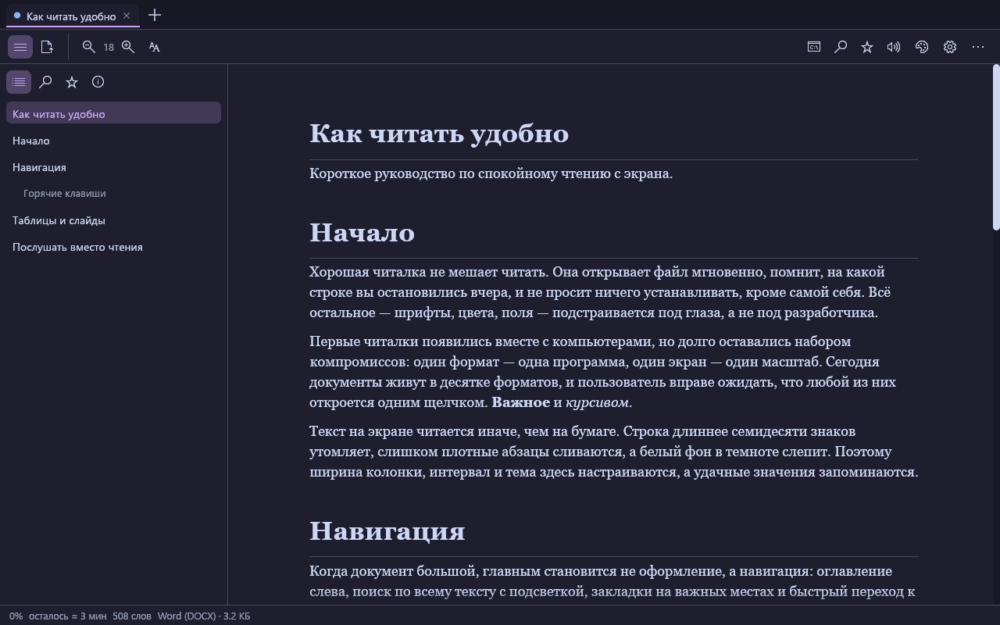
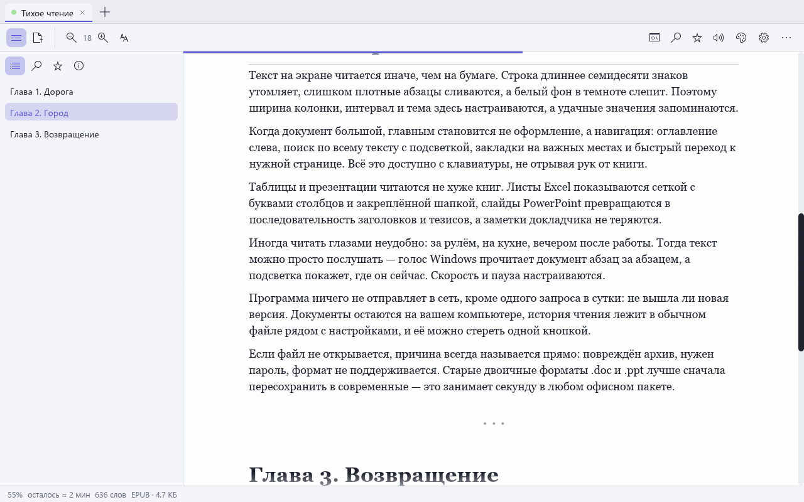
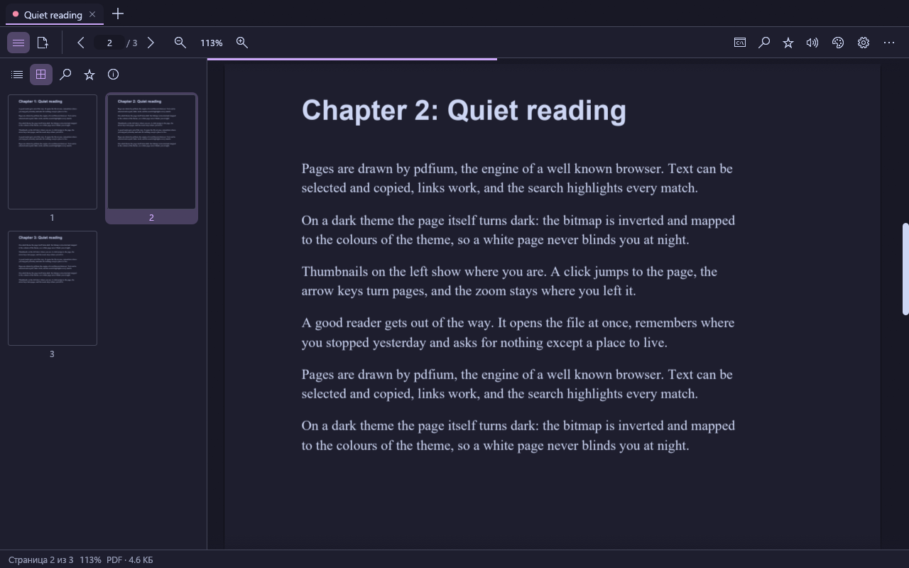
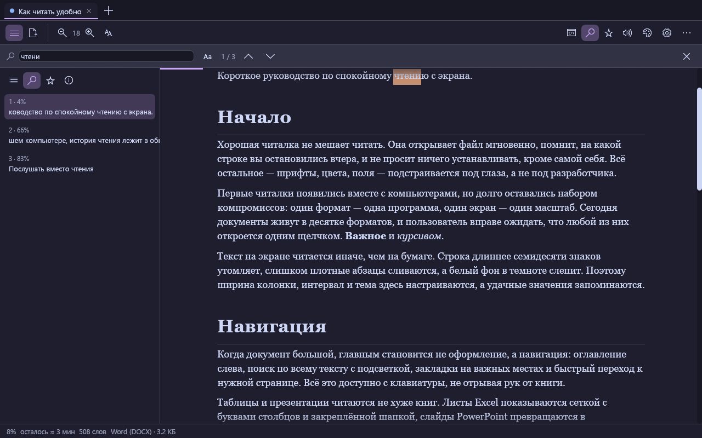
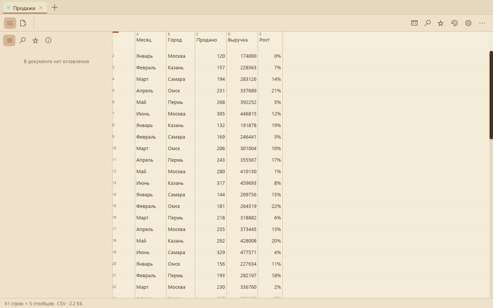
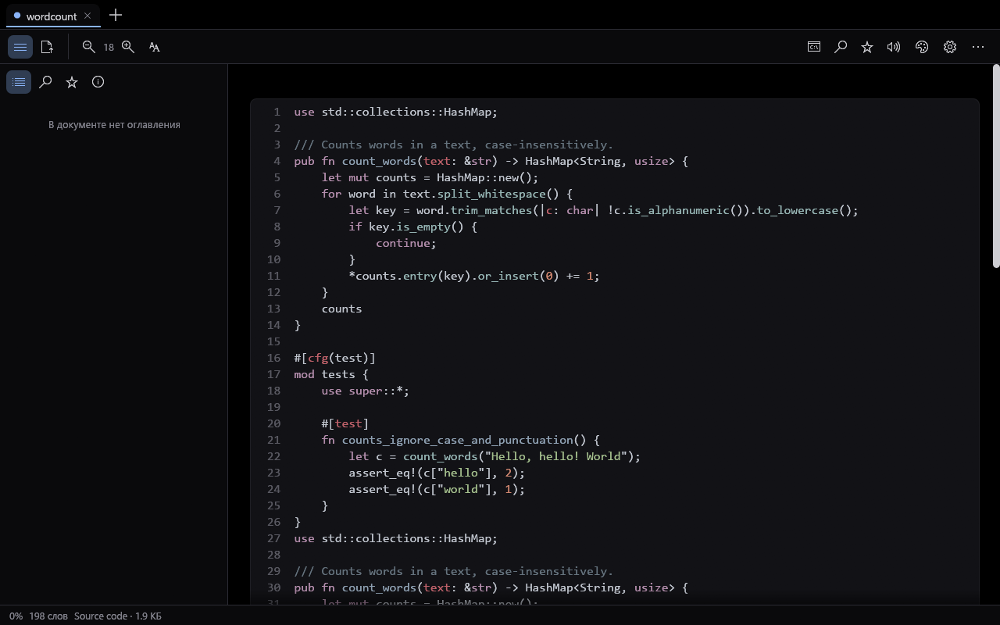
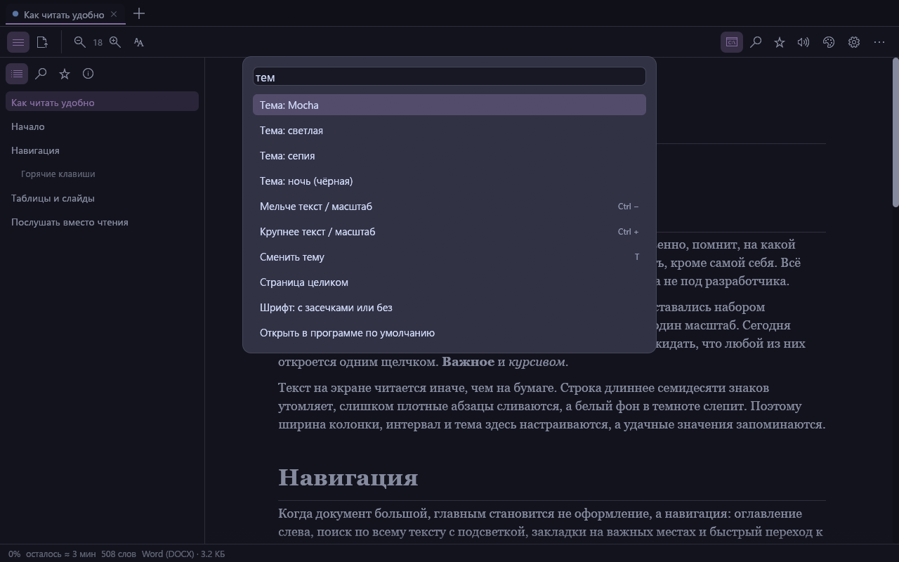
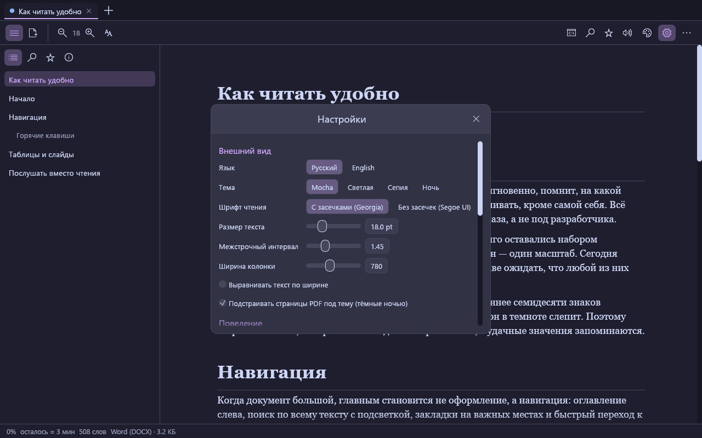

# Folio

[English](README.en.md) · [Русский](README.md)

A document reader for Windows: PDF, Word, EPUB, FB2, spreadsheets, presentations, Markdown, source code and pictures in
one tabbed window. It remembers where you stopped, searches with highlights, reads aloud with a Windows voice and fits
your eyes: four themes (Catppuccin Mocha, Light, Sepia, Night), serif and sans fonts, column width, line spacing.
Written in Rust (egui); PDF pages are drawn by pdfium, the engine of Chrome.



*All screenshots show made-up documents (`Folio.exe --screenshots`) — no real files appear in them.*

## Features (version 0.1.0)

- **Formats.** PDF (pages as in the original, text selection and copy, links, outline, passwords), DOCX/DOCM, ODT, RTF,
  EPUB, FB2 (including `.fb2.zip`, any encoding), Markdown, HTML, TXT (encoding detected: UTF-8/16, Windows-1251,
  CP866), XLSX/XLS/XLSB/ODS and CSV/TSV (a grid with column letters), PPTX and ODP (slides as sections, speaker notes),
  JSON, XML, source code with syntax highlighting, pictures and CBZ comics. Old binary `.doc` and `.ppt`, DjVu and CBR
  are not supported: save them in a modern format first.
- **Comfortable reading.** A text column of the right width, real bold and italic, tables, lists, pictures, quotes,
  links (confirmed before they open in the browser). Font size, line spacing, justification. Colours from the document
  are replaced with the theme's ink when they cannot be read on the background.
- **Themes and PDF.** On dark themes PDF pages turn dark themselves (the bitmap is inverted and mapped to the theme
  colours), on Sepia they look like paper. Can be turned off in the settings.
- **Search.** `Ctrl+F` — the whole document with every match highlighted, `F3` / `Shift+F3` to step, and a result list
  in the sidebar; case-sensitive in PDF, by cell in spreadsheets.
- **Navigation.** Tabs, contents (from headings, PDF bookmarks, EPUB NCX/nav), page thumbnails, go to page `Ctrl+G`,
  bookmarks `Ctrl+B`, next/previous file in the folder `Alt+→` / `Alt+←` (handy for books and comics), a progress strip
  and "≈ 12 min left".
- **Remembers your place.** Close a book and tomorrow it opens at the same paragraph and zoom. The place survives a font
  size change. Recent files with a progress bar on the start screen.
- **Reads aloud.** `Ctrl+L` — a Windows voice (SAPI; Russian is picked automatically when installed) reads paragraph by
  paragraph with highlighting and auto-scroll; pause, speed in the settings.
- **Command palette.** `Ctrl+K` searches commands, tabs and recent files. `T` changes the theme, `F11` is full screen.
- **Save.** All text to the clipboard or a `.txt`; a PDF or comic page as PNG; printing through the program Windows
  uses for the file type.
- **Windows integration.** "Open with" and "Default apps" (Windows does not let programs make themselves the default —
  you choose), an optional "Read in Folio" entry in the right-click menu, one window per user: a file opened from
  Explorer appears in the running Folio. Drag and drop onto the window.
- **Install and update.** `Folio-Setup.exe` installs to `%LOCALAPPDATA%\Programs\Folio` without administrator rights.
  Once a day one request to `api.github.com`; an "Update" button, SHA-256 check against `SHA256SUMS.txt`, file swap and
  restart; `Folio.exe --update` does the same without a window.
- **Command line.** `folio-cli text file` prints the text of any supported document; also `info` and `formats`.















## Keyboard

| Keys | Action |
|---|---|
| `Ctrl+O` | open a file (or drop it onto the window) |
| `Ctrl+K` | command palette |
| `Ctrl+F`, `F3`, `Shift+F3` | find, next, previous |
| `Ctrl+G` | go to a page / percentage / row |
| `Ctrl+B` | bookmark |
| `Ctrl+L` | read aloud |
| `Ctrl +`, `Ctrl −`, `Ctrl+0`, `Ctrl`+wheel | PDF zoom or font size |
| `Space`, `PgDn`, `PgUp`, `↑`, `↓`, `J`, `K`, `Home`, `End` | scroll; `←` `→` turn PDF pages |
| `Alt+→`, `Alt+←` | next / previous file in the folder |
| `Ctrl+Tab`, `Alt+1…9`, `Ctrl+W` | tabs |
| `T`, `F11`, `Ctrl+,` | theme, full screen, settings |
| `Ctrl+P` | print |

## Install

Download `Folio-Setup.exe` from [Releases](https://github.com/ahsoggg-creator/folio/releases/latest) and run it. No
administrator rights are needed: the program goes to `%LOCALAPPDATA%\Programs\Folio`, a Start menu shortcut appears,
"Apps & features" gets an uninstall entry and "Open with" lists Folio. A portable `Folio.exe` works too (it can be
installed later from Settings); `folio-cli.exe` is the console version.

The executables are **not signed**: SmartScreen may show "unknown publisher" ("More info" → "Run anyway"). Compare the
file with `SHA256SUMS.txt` from the same release to check it.

## Privacy

Folio sends nothing anywhere except the update check on GitHub (once a day, can be turned off in the settings). There is
no telemetry and documents never leave the computer. Stored locally: settings and reading history
(`%APPDATA%\Folio\settings.json`, `library.json`), a log and crash reports (`%APPDATA%\Folio\logs`, with the user
profile replaced by `%USERPROFILE%`), and the unpacked pdfium library (`%LOCALAPPDATA%\Folio`). "Clear reading history"
in the settings erases `library.json`.

## Build

```powershell
cargo test --workspace            # 77 tests, including the real pdfium
cargo build --release             # target\release\Folio.exe and folio-cli.exe
target\release\Folio.exe --screenshots docs\screenshots   # regenerate the screenshots (off-screen window)
powershell -ExecutionPolicy Bypass -File scripts\release.ps1   # checks + dist\ with checksums
```

Layout: `crates/core` reads formats into one document model (blocks, styles, tables, images) and hosts the PDF engine
(pdfium on its own thread); `crates/app` is the egui window, settings, history, installer, updater, Explorer
integration and speech; `crates/cli` is the console `folio-cli`. pdfium (`assets/pdfium/pdfium.dll`, pinned by SHA-256)
is embedded in `Folio.exe` and unpacked when the first PDF is opened, so installing and updating stay a one-file swap.

Releasing: bump the version in `Cargo.toml`, update `docs/RELEASE_NOTES.md`, `git tag vX.Y.Z && git push --tags` —
GitHub Actions builds, checks and publishes the files.

## What was not verified, and limits

Verified by tests (77), a sandboxed registry branch and rendering the window off-screen. **Not verified live:** speech
(the sound), several monitors and display scaling above 100 %, the Explorer menu and "Open with" on a real system,
updating from a real release, printing. Not supported: `.doc`, `.ppt`, DjVu, CBR/RAR, a two-page spread, editing and
annotations. DOCX footnotes and equations are not shown.

## License

MIT or Apache-2.0, at your option. Third-party components are listed in [THIRD_PARTY_NOTICES.md](THIRD_PARTY_NOTICES.md).
